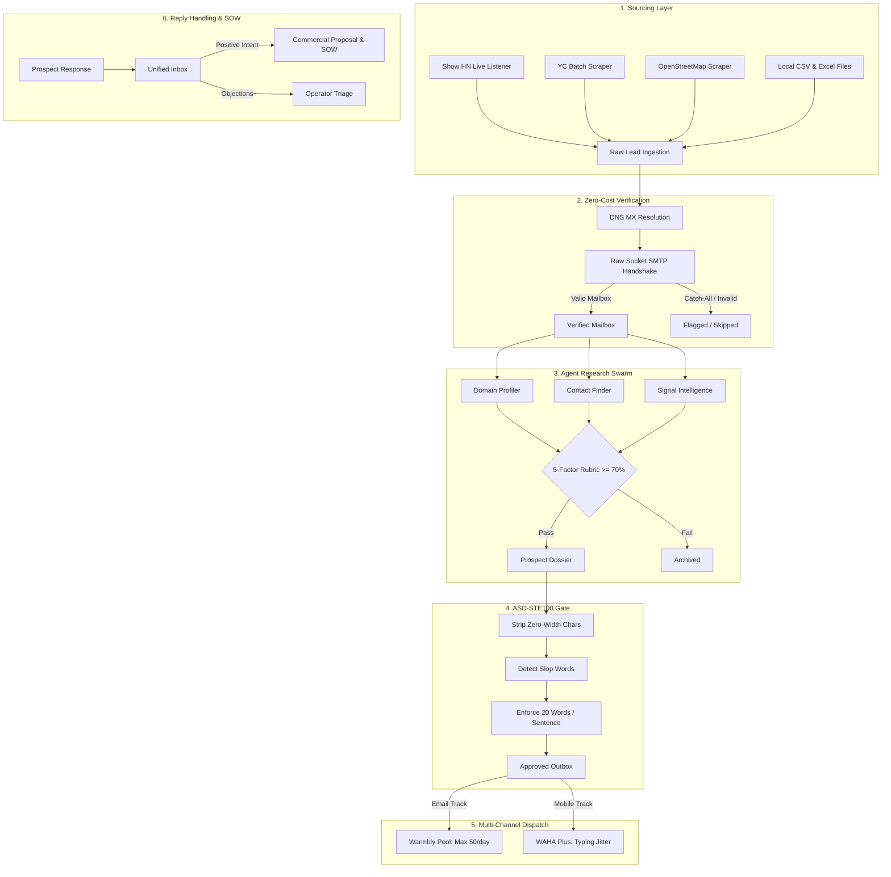

# Arcon: Project Context & Architecture Guide

## 1. Executive Overview

Arcon is an autonomous outbound sales and lead qualification engine.
The system discovers B2B leads, verifies contact mailboxes, qualifies targets, and dispatches multi-channel outreach.
The engine operates with zero third-party verification subscription fees.
All copy conforms strictly to the ASD-STE100 (Simplified Technical English) specification.

---

## 2. Monorepo Architecture

The project uses a Turborepo monorepo powered by the Bun runtime.

```
arcon/
├── .agents/
│   ├── rules/
│   │   └── ste100.md               # Strict ASD-STE100 enforcement rules
│   └── skills/
│       └── arcon/
│           ├── SKILL.md            # Antigravity skill specification
│           └── SCHEDULE_RUNBOOK.md # Recurring autonomous cron runbook
├── apps/
│   ├── mcp-gateway/                # Model Context Protocol tool server (10 tools)
│   │   └── src/index.ts
│   └── web/                        # Next.js 15 command dashboard (Port 3030)
│       ├── app/
│       │   ├── api/leads/          # Live REST API for search, verify, research
│       │   ├── layout.tsx
│       │   └── page.tsx            # Radar, Kanban, Inbox, STE100 Composer
│       └── package.json
├── packages/
│   ├── shared-types/               # Zod schemas (RawLead, ProspectDossier, etc.)
│   ├── copy-linter/                # ASD-STE100 validator & 113 corporate slop detector
│   ├── verifier/                   # Zero-cost raw socket SMTP handshake engine
│   ├── scrapers/                   # Show HN, YC directory, Maps, and CSV parsers
│   ├── agent-core/                 # 5-agent research swarm & 5-factor rubric
│   ├── database/                   # Drizzle ORM schema, PostgreSQL 16, and LeadStore
│   ├── outbound-email/             # Warmbly fleet worker with 50/day send caps
│   ├── outbound-wa/                # WAHA Plus WhatsApp dispatcher with typing jitter
│   └── doc-generator/              # ASD-STE100 commercial proposal & SOW generator
├── docker-compose.yml              # PostgreSQL (pgvector), Redis, and WAHA services
├── PROJECT_CONTEXT.md              # This architecture document
└── package.json
```

---

## 3. Strict ASD-STE100 Language Rules

All documentation, agent prompts, and outreach templates must satisfy ASD-STE100 rules:

1. **Sentence Length:**
   - Instruction sentences must contain 20 words or fewer.
   - Descriptive sentences must contain 25 words or fewer.
2. **Grammatical Voice:**
   - Use active voice only. Never use passive voice.
3. **Instruction Mood:**
   - Write instructions in the imperative mood (e.g., "Open the file", "Verify the host").
4. **Fluff & Slop Elimination:**
   - Do not use corporate filler words like "synergy", "seamless", "cutting-edge", "game-changing", "leverage", or "robust".
5. **Character Cleaning:**
   - Strip all zero-width unicode characters before dispatching messages.

---

## 4. Data Layer & Schema Design

### Core Schema Definitions ([`packages/shared-types`](file:///C:/Users/DeepMehta/Organiz/Codes/arcon/packages/shared-types))

- **`RawLead`:** Normalized representation of a discovered company, decision maker, and candidate emails.
- **`ProspectDossier`:** Output of the 5-agent research swarm, containing company profile, pain signals, and the qualification score.
- **`RubricScore`:** 5-factor evaluation scoring each prospect from 0% to 100%. A score of 70% or higher qualifies the lead.

### Persistence Strategy ([`packages/database`](file:///C:/Users/DeepMehta/Organiz/Codes/arcon/packages/database))

1. **Local File Store ([`lead-store.ts`](file:///C:/Users/DeepMehta/Organiz/Codes/arcon/packages/database/src/lead-store.ts)):**
   - Saves leads to [`packages/database/data/imported-leads.json`](file:///C:/Users/DeepMehta/Organiz/Codes/arcon/packages/database/data/imported-leads.json).
   - Provides fast, offline, and reliable access without blocking on Docker network daemons.
2. **Relational Database ([`schema.ts`](file:///C:/Users/DeepMehta/Organiz/Codes/arcon/packages/database/src/schema.ts)):**
   - PostgreSQL 16 schema managed via Drizzle ORM.
   - Stores companies, contacts, signal events, outreach touches, and 1024-dimension text embeddings.

---

## 5. End-to-End Operational Workflow



---

## 6. Component Specifications

### 6.1 Sourcing & Lead Ingestion ([`packages/scrapers`](file:///C:/Users/DeepMehta/Organiz/Codes/arcon/packages/scrapers))
- **`yc.ts`:** Scrapes Y Combinator companies and founder profiles from directory launches.
- **`signals.ts`:** Listens to Hacker News Algolia feed for live "Show HN" products and hiring posts.
- **`maps.ts`:** Queries OpenStreetMap Overpass and Nominatim APIs for local businesses by keyword and city.
- **`local-leads.ts`:** Parses RFC-4180 CSV and Excel exports, extracting company names, domains, phones, and decision makers.

### 6.2 Zero-Cost Socket Verifier ([`packages/verifier`](file:///C:/Users/DeepMehta/Organiz/Codes/arcon/packages/verifier))
- Queries DNS MX records for target domains.
- Connects directly to mail exchangers on TCP port 25.
- Executes `HELO`, `MAIL FROM`, and `RCPT TO` handshake commands.
- Determines if the mailbox exists without sending an email.
- Detects catch-all configurations.

### 6.3 5-Agent Research Swarm ([`packages/agent-core`](file:///C:/Users/DeepMehta/Organiz/Codes/arcon/packages/agent-core))
- **Domain Profiler:** Fetches website meta tags and identifies target industry.
- **Contact Finder:** Extracts verified decision maker names, roles, and LinkedIn URLs.
- **Signal Intelligence:** Correlates hiring spikes, new launches, and technical stack clues.
- **Rubric Evaluator:** Scores pain severity, budget proxy, velocity, authority, and domain fit.
- **Angle Synthesizer:** Drafts a customized ASD-STE100 outreach pitch under 50 total words.

### 6.4 ASD-STE100 Copy Linter ([`packages/copy-linter`](file:///C:/Users/DeepMehta/Organiz/Codes/arcon/packages/copy-linter))
- Removes zero-width unicode characters used for email tracking.
- Identifies 113 corporate buzzwords.
- Flags any sentence exceeding 20 words.
- Returns a strict boolean approval status.

### 6.5 Multi-Channel Outbound Engines
- **Email ([`packages/outbound-email`](file:///C:/Users/DeepMehta/Organiz/Codes/arcon/packages/outbound-email)):**
  - Distributes sends across a pool of secondary inboxes.
  - Enforces a hard cap of 50 emails per inbox per day.
  - Automatically inserts unsubscription headers.
- **WhatsApp ([`packages/outbound-wa`](file:///C:/Users/DeepMehta/Organiz/Codes/arcon/packages/outbound-wa)):**
  - Integrates with the WAHA Plus API.
  - Simulates human typing delays and presence jitter.
  - Formats phone numbers to international standards.

### 6.6 Commercial Document Generator ([`packages/doc-generator`](file:///C:/Users/DeepMehta/Organiz/Codes/arcon/packages/doc-generator))
- Produces professional markdown Statements of Work.
- Includes problem statements, proposed milestones, pricing, and acceptance criteria.
- Enforces ASD-STE100 compliance throughout the document.

---

## 7. Antigravity MCP Gateway ([`apps/mcp-gateway`](file:///C:/Users/DeepMehta/Organiz/Codes/arcon/apps/mcp-gateway))

The MCP Gateway exposes 10 automated tools to Antigravity agents:

| Tool Name | Parameters | Purpose |
| :--- | :--- | :--- |
| `growth_import_leads_csv` | `filePath`, `limit` | Ingests B2B leads from local CSV or Excel files |
| `growth_verify_email` | `email` | Performs direct socket SMTP verification ($0 API cost) |
| `growth_scrape_yc` | `batch`, `limit` | Scrapes YC companies and founders |
| `growth_listen_signals` | `query`, `limit` | Mines live Hacker News Show HN launches |
| `growth_scrape_maps` | `keyword`, `city`, `limit` | Extracts local business listings and phone numbers |
| `growth_lint_copy` | `text`, `enforceSte100` | Validates copy against ASD-STE100 and flags slop words |
| `growth_research_prospect` | `domain`, `companyName` | Runs 5-agent research swarm and 5-factor rubric |
| `growth_send_email` | `to`, `subject`, `body`, `dryRun` | Validates STE100 and dispatches cold email |
| `growth_send_whatsapp` | `phone`, `text`, `dryRun` | Validates STE100 and dispatches WhatsApp touch |
| `growth_generate_proposal` | `domain`, `monthlyFeeUsd` | Generates commercial proposal and Statement of Work |

---

## 8. Web Command Dashboard ([`apps/web`](file:///C:/Users/DeepMehta/Organiz/Codes/arcon/apps/web))

The dashboard runs locally at **`http://localhost:3030`**.

### Views & Capabilities:
1. **Sourcing Radar:**
   - Real-time search across 785+ ingested company targets.
   - Filters by company name, contact, city, and country.
   - Shows decision maker names, candidate emails, phone numbers, and ratings.
2. **Pipeline Kanban:**
   - Displays leads in 4 stages: Sourced, Verified, Researched, and Contacted.
   - Displays rubric scores and socket verification badges.
3. **Unified Inbox:**
   - Centralizes incoming email and WhatsApp prospect responses.
4. **ASD-STE100 Outbound Composer:**
   - Real-time sentence word counter.
   - Pre-send gate blocking messages with sentences longer than 20 words.
   - Direct integration with the Warmbly email fleet.

---

## 9. Developer & Operational Runbook

### Starting the Web Dashboard
```bash
bun run --cwd apps/web dev
```
Open [`http://localhost:3030`](http://localhost:3030) in your web browser.

### Running Automated Monorepo Tests
```bash
bun test
```
Executes all 19 unit tests across all packages.

### Ingesting Local Lead Datasets
```bash
bun run packages/database/src/ingest-local-leads.ts
```
Reads files from `C:\Users\DeepMehta\Organiz\Research\github\marketing-and-leads\Leads` and updates the local store.

### Production Deployment Checklist
1. **Server Selection:** Deploy to a Linux VPS (e.g., Hetzner or DigitalOcean) with open outbound TCP port 25.
2. **Database:** Run `docker compose up -d postgres` on the Linux host to enable PostgreSQL 16 with `pgvector`.
3. **Environment Variables:** Provide `DATABASE_URL`, `WARMBLY_API_KEY`, and `WAHA_ENDPOINT` in `.env`.
4. **Background Cron:** Configure the Antigravity cron schedule defined in [`.agents/skills/arcon/SCHEDULE_RUNBOOK.md`](file:///C:/Users/DeepMehta/Organiz/Codes/arcon/.agents/skills/arcon/SCHEDULE_RUNBOOK.md).
